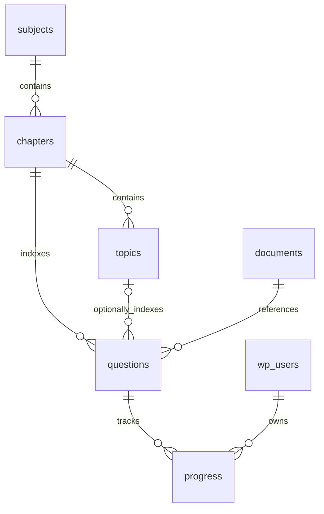

# Architecture — 0.1.0

## Runtime and files

The plugin is pure PHP 8.1+, MySQL/MariaDB, vanilla browser JavaScript and CSS. WordPress supplies authentication, session nonces, capabilities and REST routing. There are no frontend packages, Composer dependencies, external service keys or network calls from the plugin.

| File | Responsibility |
| --- | --- |
| `ca-final-command-center/ca-final-command-center.php` | WordPress plugin header, activation and component bootstrap |
| `includes/class-cafcc-db.php` | Whitelisted table names, versioned `dbDelta` schema setup, idempotent subject seeding |
| `includes/class-cafcc-repository.php` | Master permission checks, record validation, relationships, queries and progress ownership |
| `includes/class-cafcc-rest.php` | Explicit routes, authentication/nonces, bounded requests, response cache policy |
| `includes/class-cafcc-admin.php` | Administrator menu and editor shell |
| `includes/class-cafcc-frontend.php` | Student shortcode, no-cache signals and signed-in shell |
| `assets/admin.js` | Record-type forms, approval fields, edit/delete operations and pagination |
| `assets/student.js` | Student subject/chapter filters, progress status updates and simple summary |
| `assets/app.css` | Scoped responsive styles and touch-sized controls |
| `tests/` | Disposable real WordPress/MariaDB integration tests and PHP syntax checks |
| `scripts/build.py` | Deterministic ZIP packaging with one top-level plugin directory |
| `.github/workflows/build-plugin.yml` | Isolated tests, syntax validation and downloadable ZIP artifact |

## Data relationships

Every custom table begins with the current WordPress site's `$wpdb->prefix . 'cafcc_'`. Entities `questions` and `progress` map to suffixes `question_references` and `student_progress`; the other four entities use their entity names. The prototype's incompatible `cafcc_questions` and `cafcc_progress` tables are preserved without modification.

- Subjects contain a unique code and display name. Initial codes: `FR`, `AFM`, `AUDIT`, `DT`, `IDT`, `IBS`.
- Chapters store subject, title, syllabus version and order position.
- Topics belong to one chapter. A question's topic, if present, must belong to its selected chapter.
- Documents store source type, actual exam-attempt/context text, syllabus version, official URL and verification status.
- Questions reference a document/chapter/topic and store a question number, short title, verification status and Draft/Published status. Syllabus version, exam attempt, source type and official URL are normalized through their source/chapter relationships; the explorer joins them for display.
- Progress has a unique `(user_id, question_id)` index, status and UTC update timestamp. Missing rows mean Not Started. Writes use an atomic upsert scoped to the current user and a currently visible question.

WordPress `dbDelta` does not manage foreign keys here. Relationship validation, restricted deletion and structural-edit checks live in the repository. Administrative writes should be sequential in this initial version; concurrent master edits are not serialized. Use a database backup before bulk administration. User deletion/privacy export/erasure automation is a future task; deleted-user progress currently remains until an administrator handles data retention outside this version.

## Schema migration lifecycle

Plugin version `0.1.0` is separate from schema version `1` in `cafcc_db_version`.

- Activation and plugin startup call migration when the stored schema differs.
- Migration from an absent/version-0 schema creates or reconciles the six tables with `dbDelta`, checks expected tables/columns and inserts the six missing subject codes with `INSERT IGNORE`.
- Only successful setup advances the option. Repeating a partial migration does not duplicate subjects or erase existing records.
- Future schema changes must increase `CAFCC_DB::VERSION`, add any required data transformation, and add migration regression tests. A stored newer schema is refused rather than downgraded; REST access fails closed with 503 until compatible code/setup is restored.
- Network-wide activation is rejected. Per-site activation uses that site's prefix.
- The earlier repository prototype has no verified source/syllabus metadata. Its tables and private notes remain untouched, an administrator notice explains the separation, and `[cafcc_dashboard]` aliases the new shortcode. No automatic legacy publication or progress-ID mapping is attempted. A reviewed legacy migration remains a future task when real prototype records exist.
- There is no destructive deactivation/uninstall routine. Removing plugin files retains academic tables and progress.

## Security boundary

All master mutation routes require a current WordPress user with `read`, a valid `wp_rest` nonce in `X-WP-Nonce`, and administrator authorization. Repository save/delete methods repeat the administrator check. An Editor with a separately granted `manage_options` capability still cannot edit master records.

All student read/write routes require sign-in, `read`, and a valid REST nonce. They do not accept an owner ID. Summary/explorer SQL joins progress against `get_current_user_id()`; writes obtain the same value on the server. The progress body must contain only `status`. Public users cannot read these student routes. There are no import routes or public write endpoints.

Input handling uses strict field allowlists, bounded request sizes (16 KB), bounded page numbers, scalar/type checks, positive ID validation, text sanitization, enum checks and relationship validation. SQL values use `$wpdb->prepare`, `$wpdb->insert`, `$wpdb->update` and `$wpdb->delete`; table/column identifiers come only from internal allowlists. Browser-rendered values use `textContent` and WordPress output uses context-appropriate escaping.

Official resource links accept only direct HTTPS `icai.org`/`icai.nic.in` URLs and their subdomains, without credentials, query, fragment or port. Nothing is fetched or embedded. This prevents publishing private Google Drive URLs as resource links; it does not establish academic accuracy or guarantee a source is reachable.

Question visibility is reused for the explorer, summary, chapter catalog and progress writes. Both question and document must be verified, question must be published, source must have an official URL, and syllabus versions must match. Revoking source verification hides its references without deleting progress.

## REST surface

Base namespace: `/wp-json/cafcc/v1` (WordPress also supports `?rest_route=/cafcc/v1/…`). All routes require a nonce, including reads. These endpoints are for the first-party WordPress UI, not a nonce-free application-password integration.

| Method and route | Access and behavior |
| --- | --- |
| `GET /admin/{entity}?page=1` | Administrator; 100 master records per page |
| `POST /admin/{entity}` | Administrator; create one validated JSON record |
| `PATCH /admin/{entity}/{id}` | Administrator; edit allowed fields and/or approve/publish |
| `DELETE /admin/{entity}/{id}` | Administrator; reject when dependent records/progress exist |
| `GET /catalog` | Signed-in user; subjects and chapters with visible references |
| `GET /questions?subject_id=…&chapter_id=…&page=1` | Signed-in user; visible references, own status, 20 per page |
| `GET /summary` | Signed-in user; own counts across visible questions |
| `PUT /progress/{question_id}` | Signed-in user; body `{ "status": "needs_revision" }` |

`{entity}` is exactly one of `subjects`, `chapters`, `topics`, `documents`, `questions`. Master list metadata includes `total` and `per_page`. Expected errors include 400 validation, 401 unauthenticated, 403 denied/expired nonce, 404 unavailable record, 409 dependency/duplicate conflict, 413 oversized body and 503 incomplete/incompatible schema.

## Deployment boundary

GitHub Actions tests and packages code; it has read-only repository permissions and no Hostinger credentials/deployment action. Nothing automatically installs, merges or publishes. The plugin adds no public page. Shortcode content is generated in the browser from private REST data; exclude its page and API paths from external caches. Hosting-level staging privacy and backup restoration must be checked in the target environment before real data is added.
