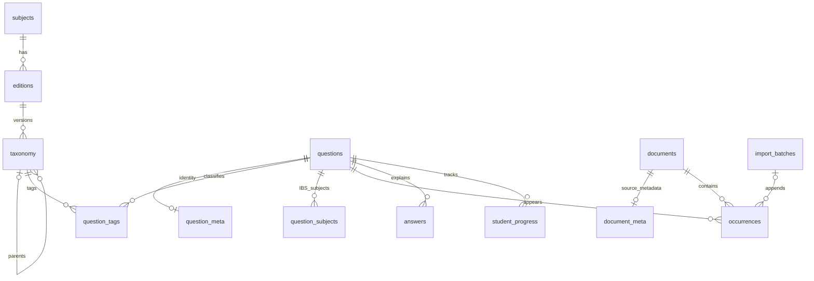

# Architecture — Version 0.2.0

Version 0.2 extends the complete [Version 0.1 foundation](ARCHITECTURE-0.1.md). The original repository/REST permissions, question identities and progress storage remain in use. No hosting runtime dependency was added.

## Components

| Component | Responsibility |
| --- | --- |
| `class-cafcc-db.php` | Schema version gate and original six table definitions; invokes additive schema 2 |
| `class-cafcc-academic-db.php` | Twelve new tables; idempotent sourced catalogue preparation |
| `class-cafcc-academic.php` | Typed records, enums, validation, parent/edition relationships, authorization and transactional writes |
| `class-cafcc-import.php` | Strict CSV templates, transactional preview, owner-bound commit plans, revalidation/locking and soft withdrawal |
| `class-cafcc-explorer.php` | Validated filter paths, published catalogues, many-to-many matching, occurrence/source filtering, answer rights and private progress joins |
| `class-cafcc-academic-ui.php` | Administrator manager, first-party REST v2 routes, bulk sourced-heading review and student shell |
| `assets/explorer.js` / `explorer.css` | Responsive student filters/cards, own progress and answer panels; scoped navy/teal/purple styling |
| `assets/manager.js` | Resource/taxonomy forms, source review and CSV file preview/commit/withdrawal |
| Original repository/REST/admin | Version 0.1 records, permissions and progress APIs; new visibility guard prevents withdrawn-batch bypass |

`taxonomy.node_type` represents module, chapter, unit, topic and subtopic entities in one typed adjacency table. Every node has a subject/edition and a validated parent type. This supports missing module/unit levels without inventing official headings. Structural moves are refused; a separate node and historical mapping preserve identity. Ordering and corrected titles can be edited in place. Many-to-many question tags use node IDs and allow several detailed classifications per question.

Existing question/source tables retain their IDs and fields. New metadata is linked by unique `question_id` / `document_id`. New questions use the original question/progress storage and a primary chapter reference; finer/cross-subject classifications live in relation tables. Existing unclassified questions remain available globally rather than being assigned an inferred syllabus. The initial explicit classification operation adds metadata without rewriting their old rows.

## REST v2

Namespace `/cafcc/v2`; both pretty and plain WordPress REST URLs are supported by the browser request builders. All routes require the original permission callback: authenticated user, `read`, matching REST nonce and ready schema. Administrator routes additionally require the administrator role and `manage_options`; repository writes repeat the authorization check.

- `GET /catalog`, `/questions`, `/summary`: validated `subject_id`, `edition_id`, `chapter_id`, `unit_id`, `topic_id`, `subtopic_id`, `source_type`, `exam_attempt`, `search`, `page`.
- `GET /answers/{question_id}`: only reviewed published solutions/links; private rights evidence is not returned.
- `GET/POST /admin/{collection}`; `PATCH /admin/{collection}/{id}`: typed master records. No destructive v2 DELETE endpoint.
- `POST /admin/review-hierarchy/{edition_id}`: explicit source-review confirmation; approves bundled official headings, not editorial tags or imported research.
- `POST /admin/import/preview`, `/admin/import/commit`, `/admin/import/rollback/{batch_id}`; `GET /admin/import/batches`.

Collections: editions, taxonomy, documents, questions, occurrences, tags, subject_tags, answers, families, comparisons, edition_mappings. Both admin lists use 100-row pagination; the manager assembles up to 10,000 records per picker. Student questions use 20-row pages and existential tag matching to avoid duplicates.

Progress continues through `PUT /cafcc/v1/progress/{question_id}`. Its owner is always the current WordPress user; no alternate progress owner field exists. Both namespaces send private/no-store headers.

## Integrity and publication

Filter IDs are validated as one real hierarchy path before querying. The deepest selected node matches its reviewed descendant tags; it is not combined with unrelated independent dropdown IDs. Source/attempt conditions must match the same occurrence. Verified marks are separate from unknown marks. Non-IBS questions cannot silently cross editions; IBS mappings may explicitly reference relevant subject editions.

A connected question needs a published verified source occurrence and edition to appear in v2. Source/question review is also checked by the original visibility logic. Batch status is part of visibility in both API versions. Taxonomy paths require reviewed published ancestors. Answers tied to withdrawn occurrences are withheld; official-link mode contains no copied solution text. Authored/licensed text needs a recorded rights basis plus explicit publication.

All identifiers come from internal table/field maps; SQL values use prepared operations. Strings, relations, stable keys, enum values, bounds and request sizes are checked. Browser output uses DOM text rather than injected HTML. Expected duplicate SQL errors are suppressed from response/log output and returned as safe conflicts. Source URLs use the original conservative direct-HTTPS ICAI-host allowlist.

CSV imports are append-only, transactionally previewed/revalidated and serialized by a site-specific MySQL advisory lock. Commit tokens are random, short-lived and bound to their administrator; retries return the original batch. A late conflict rolls back all rows in the batch. Withdrawal retains IDs and progress and refuses accidental republication. It is not a full audit/history or data-deletion system.

See [migration report](MIGRATION-0.2.md), [sources](SOURCES.md), [testing](TESTING.md) and [validation](VALIDATION.md) for evidence and limits.
